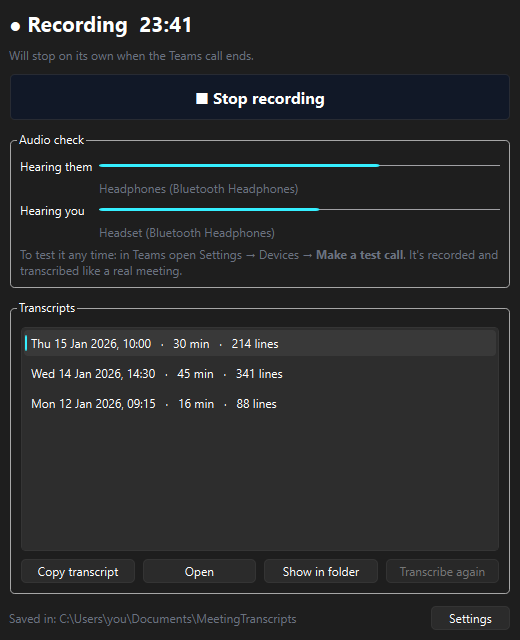
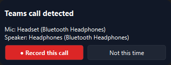

<p align="center">
  
</p>

<h1 align="center">Botless Meeting Transcriber</h1>

<p align="center">
  Teams transcripts without a bot joining your call. Runs locally on Windows.
</p>

<p align="center">
  <a href="LICENSE"></a>
  
  
</p>

---

I wanted transcripts of my Teams meetings so I could turn them into notes with an AI. Every tool I found either sent a bot into the call or uploaded the audio somewhere, and I didn't love either.

So I built one that does neither.

MeetingRecorder sits in the tray and asks if you want to record when a Teams call starts. It records your mic and whatever Teams plays to you on separate tracks, then after the call it runs Whisper on your own GPU and gives you a timestamped **Me / Others** transcript. Copy, paste into your AI of choice, done.

<p align="center">
  
  &nbsp;&nbsp;
  
</p>

## What it does

- **Notices Teams calls** and asks before recording anything.
- **Labels both sides for free.** Mic and call audio are separate tracks, so there's no speaker-identification model to get wrong.
- **Follows your devices** when headphones connect mid-call or Teams switches speaker.
- **Stops by itself** about 30 seconds after the call ends. Muting doesn't count as ending.
- **Transcribes after the call**, on the GPU if you have one. A 1.5 minute call took about 10 seconds on a mid-range laptop GPU.
- **Cleans up the text:** speaker echo, Whisper's random "Thank you." lines, and sound from devices Teams isn't using.
- **Shows you it's working** with live "Hearing them / Hearing you" meters, and warns you mid-call if something's off.
- **Survives crashes.** An app crash costs a couple of seconds at most, and anything unfinished is transcribed next launch.
- **Deletes the audio** once the transcript exists, unless you tell it not to.

## Built to be safe on a live call

The last thing I wanted was a tool that messes up a real meeting, so it follows a few hard rules:

1. **It never opens a mic on its own.** It only records a mic Teams (or another app) already has open, and lets go as soon as that app does. With Bluetooth headphones this matters: opening their mic forces them into low-quality call mode, and this app can't be the cause.
2. **It never plays sound or changes your audio settings.** Capture is shared-mode only.
3. **Nothing leaves your PC.** There's no account and no telemetry. The only network call is a one-time model download, pinned to an exact revision. Copied transcripts are even kept out of Windows clipboard history.

> **Record responsibly.** No bot means no banner in the meeting, but you may still need people's consent or your organisation's OK. Check first.

## Requirements

- Windows 11 and the new Teams desktop app (auto-detect is Teams-only, manual recording works with anything)
- [uv](https://docs.astral.sh/uv/), which installs Python 3.12 for you
- An NVIDIA GPU is recommended but not required
- About 1.6 GB for the speech model ([`faster-whisper-large-v3-turbo`](https://huggingface.co/mobiuslabsgmbh/faster-whisper-large-v3-turbo), downloaded on first use), plus about 2 GB of NVIDIA libraries for GPU mode

## Install

```powershell
git clone https://github.com/theSudoer/botless-meeting-transcriber.git
cd botless-meeting-transcriber
uv sync --extra cuda         # no NVIDIA GPU? just: uv sync
uv run meetingrecorder --install
```

That adds **MeetingRecorder** to the Start Menu. Open it, right-click the taskbar icon and pin it.

## Use it

1. Leave it running. Closing the window keeps it in the tray.
2. Join a Teams call and click **Record this call**.
3. Hang up. It stops, transcribes and tells you when it's ready.
4. Pick the meeting and hit **Copy transcript**.

Transcripts are plain Markdown in `Documents\MeetingTranscripts`:

```markdown
# Meeting 15 Jan 2026, 10:00 (30 min)

_Recorded locally. Me = Headset (Bluetooth Headphones); Others = Headphones (Bluetooth Headphones)._

**[00:00:12] Others:** Morning everyone, shall we start with the release plan?

**[00:00:18] Me:** Sounds good. I can take the first item.
```

That second line names your audio devices, so delete it before pasting if you'd rather not share it.

**Testing without a meeting:** Teams Settings, Devices, **Make a test call**. It's recorded like a real call.

**Checking what the app sees:** this read-only command lists your audio devices, which apps are using them, whether a call is detected and whether a CUDA GPU is visible. Safe to run mid-call.

```powershell
uv run python -m meetingrecorder.diagnose
```

## Good to know

- **Headphones work best.** On a speaker your mic hears the call too. Most of that echo gets removed, but not all of it when you talk over someone.
- **Don't play other audio on the same headphones during a meeting.** It'll end up under "Others".
- **Your mic is still recorded while you're muted in Teams.** Teams keeps it open, so the app does too.
- **English only for now.** It's a one-line change in `transcriber.py`.
- If you point the transcripts folder at OneDrive or Dropbox, your transcripts leave the PC through that sync.

## How it works

```
 Teams call starts ──► scanner (1 s): which devices is Teams using?
                         │
        "Record this call?" ──► capture (10 ms): mic Teams uses + loopback of every output
                         │                       crash-safe WAV per device, one shared clock
 Teams releases mic ─────┘ (+30 s) ──► stop
                         │
                         ▼
 transcriber: cut each track into sound regions ─► Whisper (GPU) ─► keep Teams' device only
              ─► drop echo + hallucinations ─► merge into paragraphs ─► transcript.md
```

The interesting part was everything that broke along the way. Bluetooth headphones turn out to be several devices pretending to be one. Windows' per-app audio capture can't hear Teams calls at all. And Whisper's voice detector quietly dropped my speech after a long silence, with no error.

The full write-up is in **[docs/how-it-works.md](docs/how-it-works.md)**.

## Development

```powershell
uv run pytest              # fast unit tests
uv run pytest -m model     # runs the real speech model (GPU recommended)
uv run ruff check src tests
```

| Module | Job |
|---|---|
| `winaudio.py` | devices, per-app audio sessions, WASAPI capture on a shared clock |
| `engine.py` | call detection, device following, capture, alarms, auto-stop, crash recovery |
| `transcriber.py` | Whisper per sound region, Teams-device filter, echo and hallucination cleanup |
| `wavio.py` | crash-safe WAV writer and reader |
| `app.py` | the window, tray icon and call prompt |
| `diagnose.py` | read-only device and call check |

Found a security issue? See [SECURITY.md](SECURITY.md).

## Licence

MIT. See [LICENSE](LICENSE).
